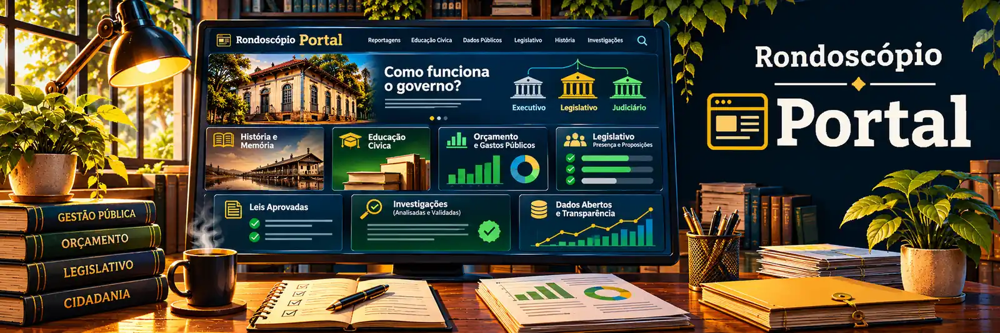

# Portal

Projeto do **Rondoscópio** no repositório **Rondoscopio/portal**.

O Portal pretende reunir informações de interesse público sobre Rondônia, sua história, suas instituições, a atuação dos agentes públicos e o uso dos recursos da sociedade. Será um espaço de educação cívica, transparência, pesquisa, acompanhamento de políticas públicas e publicação de investigações.

## Objetivos

As áreas abaixo descrevem o escopo pretendido. O projeto está em planejamento e nenhuma funcionalidade deve ser considerada disponível apenas por estar listada aqui.

### História, educação e instituições

- **Educação cívica:** explicar como funcionam os poderes Executivo, Legislativo e Judiciário, as instituições de controle, o processo legislativo, as eleições, as competências estaduais e municipais e os direitos dos cidadãos.
- **História e memória de Rondônia:** reunir pesquisas e cronologias sobre os povos indígenas, a formação do estado, as migrações, a ocupação territorial, os municípios, os movimentos sociais, a ditadura militar, a redemocratização e as transformações políticas, sociais, econômicas e ambientais.
- **Memória política:** documentar governos, acontecimentos, decisões, crises, reformas e mudanças institucionais ao longo do tempo.
- **Quem é quem:** apresentar perfis documentados de autoridades e agentes públicos, seus cargos, mandatos, atribuições, trajetórias, decisões e histórico de atuação.
- **Biblioteca pública:** organizar legislação, atas, decisões, relatórios, documentos históricos, pesquisas acadêmicas e outras fontes de interesse público.

### Fiscalização dos três poderes

- **Executivo:** acompanhar atos administrativos, orçamento, contratos, serviços públicos, programas, decisões e resultados.
- **Legislativo:** acompanhar assembleias e câmaras municipais, comparecimento às sessões, votações, discursos, comissões, despesas e atividade dos parlamentares.
- **Judiciário:** apresentar informações públicas sobre gestão, orçamento, despesas, atos administrativos, produtividade e transparência, respeitados os limites legais de acesso e a independência judicial.
- **Processo legislativo:** acompanhar projetos de lei apresentados, aprovados, rejeitados, arquivados e em tramitação, incluindo autoria, emendas, votações, sanções e vetos.
- **Órgãos de controle:** acompanhar fiscalizações, recomendações, auditorias e decisões públicas de instituições de controle, com atenção às suas competências e ao andamento dos procedimentos.
- **Atos e decisões com efeitos econômicos ou sociais:** examinar efeitos documentados de leis, regulamentos, decisões administrativas e decisões judiciais públicas sobre direitos, serviços, concorrência e distribuição de benefícios, respeitando as competências de cada poder.

### Dinheiro público e Follow the Money

- **Orçamento e despesas:** apresentar receitas, despesas, orçamento previsto e executado, PPA, LDO, LOA, empenhos, liquidações e pagamentos.
- **Contratos e licitações:** acompanhar editais, participantes, fornecedores, valores, aditivos, execução, pagamentos e possíveis concentrações de contratações.
- **Emendas e transferências:** identificar autoria, origem, destino, execução e beneficiários de emendas parlamentares, convênios e repasses públicos.
- **Siga o Dinheiro (Follow the Money):** reconstruir, até onde a documentação permitir, o percurso dos recursos públicos desde a origem até os destinatários, contratos, subcontratações documentadas e entregas realizadas.
- **Redes econômicas:** apresentar relações documentadas entre órgãos, empresas, sócios, fornecedores e intermediários, com apoio de grafos e visualizações de fluxos financeiros.
- **Beneficiários de decisões públicas:** identificar, quando possível, quem recebe benefícios econômicos decorrentes de contratos, subsídios, incentivos, alterações legislativas, atos administrativos ou decisões judiciais públicas, diferenciando beneficiários diretos, indiretos e efeitos ainda incertos.
- **Vínculos e possíveis favorecimentos:** examinar relações pessoais, familiares, profissionais, societárias ou políticas entre agentes públicos e beneficiários de decisões, incluindo amigos e pessoas com negócios relacionados, somente quando houver documentação pertinente e interesse público demonstrável. Investigar critérios, alternativas, processo decisório e tratamento dado a outros interessados, sem presumir favorecimento ilícito por existir um vínculo.
- **Conflitos de interesses e captura de decisões:** analisar situações em que interesses privados possam influenciar atos estatais, mudanças regulatórias, concessões de benefícios ou contratações, distinguindo evidências verificadas, hipóteses e conclusões.
- **Padrões atípicos:** divulgar análises revisadas sobre concentração de pagamentos, recorrência de fornecedores, preços fora do padrão e outras situações que mereçam apuração, sem tratar anomalias como provas de ilícito.

### Políticas públicas, metas e omissões

- **Obras públicas:** acompanhar obras previstas, iniciadas, paralisadas e concluídas, com seus valores, prazos, aditivos, pagamentos e entregas.
- **Políticas públicas:** apresentar objetivos, recursos, cobertura e resultados em saúde, educação, segurança, saneamento, assistência social, infraestrutura, meio ambiente e outras áreas.
- **Cumprimento de metas:** comparar metas oficiais, indicadores, prazos, recursos disponíveis, execução e resultados efetivamente observados.
- **Promessas e compromissos:** confrontar declarações e compromissos públicos de autoridades com medidas adotadas, decisões documentadas e resultados conhecidos.
- **Omissões do poder público:** examinar possíveis descumprimentos de deveres legais, prazos, providências e obrigações de prestação de serviços. A caracterização de omissão deve considerar competência, contexto, justificativas e evidências.
- **Efetividade do gasto:** investigar a relação entre recursos empregados, serviços ou obras entregues e benefícios verificáveis à população.
- **Distribuição de serviços e equipamentos:** comparar a localização de creches, escolas, unidades de saúde, serviços assistenciais e outros equipamentos com população atendida, demanda observada e estimada, distância, capacidade, vagas e acessibilidade.
- **Bairros desassistidos:** identificar áreas com necessidades documentadas e cobertura insuficiente de políticas públicas, inclusive bairros periféricos e comunidades rurais, examinando a distribuição territorial dos investimentos e a ausência de respostas proporcionais à demanda.
- **Planejamento e prioridades:** verificar se critérios técnicos, dados demográficos, diagnósticos de necessidade e participação social fundamentaram a localização de obras, serviços, vagas e benefícios. A concentração geográfica de equipamentos, por si só, não demonstra desperdício ou irregularidade.
- **Avaliação de políticas:** reunir pesquisas acadêmicas, experiências comparáveis e evidências de resultados positivos ou negativos, distinguindo correlação e causalidade.

### Indicadores e desigualdades

- **Indicadores socioeconômicos:** acompanhar renda, emprego, educação, saúde, saneamento, pobreza, desenvolvimento humano e qualidade de vida.
- **Desigualdade de renda:** apresentar índices como o Gini de renda, distribuição dos rendimentos, pobreza, extrema pobreza e concentração de renda.
- **Desenvolvimento humano:** acompanhar IDH e IDHM, respeitando o período, a metodologia e a disponibilidade de cada indicador.
- **Concentração fundiária:** analisar a distribuição da propriedade e da posse da terra, a estrutura dos estabelecimentos agropecuários e medidas como o Gini fundiário quando houver dados adequados.
- **Desigualdades territoriais e sociais:** comparar municípios, bairros, áreas urbanas e rurais e grupos populacionais, com atenção às diferenças de acesso a direitos, serviços e oportunidades.
- **Desigualdades por grupos sociais:** acompanhar, quando existirem dados adequados, disparidades por raça ou cor, gênero, faixa etária, deficiência, renda e outros recortes relevantes, observando a qualidade das bases e a proteção dos indivíduos.
- **Educação e primeira infância:** acompanhar matrículas, acesso à creche, fila por vagas, cobertura por faixa etária, permanência escolar, aprendizagem, infraestrutura e distribuição territorial de equipamentos educacionais.
- **Séries históricas:** permitir comparações entre períodos, localidades e políticas, com indicação das mudanças metodológicas que afetem a leitura dos dados.

### Direitos humanos, violência e proteção de pessoas

- **Violações de direitos humanos:** documentar e contextualizar denúncias, relatórios, decisões e indicadores sobre possíveis violações praticadas por agentes públicos ou particulares, distinguindo fatos comprovados, casos em apuração e alegações.
- **Violência contra mulheres:** acompanhar feminicídios, violência doméstica, sexual e outras formas de violência, além da cobertura dos serviços de acolhimento, atendimento e proteção.
- **Direitos de crianças e adolescentes:** analisar indicadores de violência, abuso, exploração, negligência, trabalho infantil, evasão escolar e acesso à rede de proteção, respeitando integralmente a privacidade das vítimas.
- **Violência e discriminação contra pessoas LGBTQIA+:** acompanhar registros disponíveis, políticas de proteção, atendimento, discriminação e barreiras de acesso a direitos.
- **Racismo e outras discriminações:** examinar indicadores, denúncias documentadas e ações públicas relacionadas a discriminação racial, violência contra povos indígenas e outros grupos sujeitos a vulnerabilidades.
- **Violência institucional:** acompanhar denúncias e dados públicos sobre abuso de autoridade, violência policial, condições de privação de liberdade e falhas de atendimento por instituições.
- **Prevenção e resposta do Estado:** verificar recursos, metas, cobertura e resultados de delegacias especializadas, conselhos tutelares, serviços de acolhimento, assistência jurídica e redes de atendimento.
- **Proteção de vítimas e fontes:** evitar identificação indevida, exposição de crianças e adolescentes, divulgação de endereços sensíveis e combinações de dados que permitam reidentificar vítimas, mesmo quando parte dos registros seja pública.

### Acesso territorial a direitos e serviços

- **Desigualdade entre bairros:** comparar cobertura e qualidade de serviços públicos, infraestrutura, transporte, saneamento, saúde, educação e assistência social, considerando indicadores locais e mudanças demográficas.
- **Demanda por creches e escolas:** confrontar localização, capacidade e ocupação dos equipamentos com população infantil, demanda reprimida, tempo de deslocamento, filas e distribuição das vagas. Diferenciar oferta concentrada de oferta efetivamente incompatível com a necessidade.
- **Territórios negligenciados:** investigar localidades com problemas persistentes e pouca presença de políticas públicas, examinando pedidos da população, prioridades orçamentárias, critérios de atendimento e providências adotadas ou omitidas.
- **Distribuição do investimento público:** apresentar quanto cada região recebe em obras, manutenção, equipes e serviços, com comparações proporcionais à população e às necessidades identificadas.
- **Equidade no acesso:** avaliar se a distribuição de recursos e oportunidades contribui para reduzir ou ampliar desigualdades sociais, territoriais, raciais, de gênero e de renda, sem atribuir causalidade sem evidências suficientes.

### Investigações e verificações

- **Reportagens e investigações:** publicar apurações de interesse público apoiadas em documentos, dados, análise crítica e revisão editorial humana.
- **Denúncias:** divulgar somente conteúdos que tenham passado por triagem, apuração, avaliação de riscos, revisão humana e procedimentos adequados de contraditório e direito de resposta.
- **Checagem de fatos:** verificar afirmações e informações públicas, explicar o contexto, apresentar evidências e distinguir fatos, interpretações, hipóteses e conclusões.
- **Relações de interesse público:** apresentar vínculos documentados, possíveis conflitos de interesses e inconsistências relevantes, sem inferir culpa a partir de uma conexão isolada.
- **Favorecimento e benefícios privados:** investigar, com base em evidências, se atos normativos, contratos, políticas públicas ou decisões administrativas e judiciais produziram vantagens particulares e se existiram relações relevantes entre decisores e beneficiários. Um benefício ou vínculo pessoal, isoladamente, não comprova desvio de finalidade.
- **Correções e respostas:** disponibilizar esclarecimentos, retificações, atualizações e respostas recebidas, preservando um histórico identificável das alterações.

### Dados abertos e consulta pública

- **Busca unificada:** permitir consultas por pessoas, órgãos, empresas, contratos, documentos, projetos de lei, assuntos, municípios e períodos.
- **Filtros e comparações:** explorar dados por ano, localidade, instituição, representante, programa ou categoria, incluindo comparações entre períodos.
- **Visualizações:** oferecer tabelas, gráficos, séries temporais, linhas do tempo, fluxogramas, redes de relações e diagramas de fluxo financeiro.
- **Dados abertos:** disponibilizar, quando juridicamente possível, conjuntos de dados, formatos estruturados, metadados, documentação e uma futura API pública.
- **Rastreabilidade:** indicar fontes, datas de referência e atualização, critérios de tratamento, metodologias, limitações e eventuais lacunas.
- **Acompanhamento de decisões:** reunir o histórico documentado de leis, contratos, despesas e políticas, desde a origem até seus desdobramentos conhecidos.

### Participação e transparência do Rondoscópio

- **Participação cidadã:** oferecer guias de fiscalização, orientações para solicitar informações públicas e acesso à Ouvidoria.
- **Ouvidoria:** encaminhar manifestações, pedidos de correção, solicitações de resposta e denúncias ao sistema específico, sem expor dados sensíveis no Portal.
- **Sobre o projeto:** apresentar missão, princípios, Constituição institucional, metodologia de investigação, políticas editoriais e projetos relacionados.
- **Transparência institucional:** publicar decisões efetivamente tomadas, atividades, responsáveis, fontes de financiamento, despesas, declarações de conflitos de interesses e prestação de contas do próprio Rondoscópio, conforme a estrutura institucional existir.

## Fiscalização de órgãos, entidades e beneficiários de recursos públicos

O Portal deverá acompanhar a administração direta e indireta dos três poderes, do Ministério Público e de instituições autônomas, observando diferenças de natureza jurídica, competências e deveres de transparência.

- **Órgãos estaduais e municipais:** secretarias, câmaras, assembleia legislativa, tribunais, fundos, autarquias, fundações, consórcios públicos, agências reguladoras e órgãos de controle.
- **Instituições federais presentes em Rondônia:** autarquias, universidades e institutos federais, unidades de saúde e educação, órgãos de fiscalização, institutos de pesquisa, agências e superintendências regionais. O **IFRO**, por exemplo, é uma **autarquia federal vinculada ao MEC**, não uma sociedade de economia mista.
- **Estatais e sociedades de economia mista:** empresas públicas, empresas controladas pelo poder público e subsidiárias. A **CAERD** é exemplo de **sociedade de economia mista** em Rondônia. Acompanhar administração, governança, contratos, investimentos, receitas, despesas, endividamento, tarifas, desempenho, qualidade do serviço, universalização e obrigações de transparência previstas na legislação aplicável.
- **Entidades prestadoras de serviço público:** concessionárias, permissionárias, parceiras em PPP, entidades delegatárias e empresas contratadas, na medida em que seus atos e serviços estejam sujeitos à publicidade e à fiscalização cabíveis.
- **Entidades privadas com financiamento ou delegação pública:** organizações sociais, organizações da sociedade civil, fundações, associações, hospitais conveniados e outras beneficiárias de subvenções, termos de parceria, contratos ou convênios, quanto aos recursos, obrigações e resultados pertinentes.
- **Conselhos e entidades profissionais:** conselhos de fiscalização profissional, quando sujeitos às regras de transparência e controle aplicáveis, distinguindo seu regime jurídico das associações privadas.
- **Organismos de cooperação:** consórcios intermunicipais, arranjos regionais, fundos, programas entre esferas de governo e entidades responsáveis por projetos com múltiplas fontes de financiamento.
- **Relações entre agentes e beneficiários:** identificar sócios, dirigentes, contratos, parcerias, incentivos fiscais, legislação favorável, decisões administrativas e judiciais, quando houver documentação pública pertinente e interesse público. Amizade, parentesco ou vínculo econômico não demonstram, isoladamente, favorecimento indevido.

### Exemplos de acompanhamento por entidade

- **CAERD:** cobertura e continuidade do abastecimento, perdas de água, tratamento, investimentos, qualidade do serviço, reclamações, metas contratuais e regulatórias, contratos, governança e demonstrações financeiras.
- **IFRO:** orçamento, execução de recursos, assistência estudantil, matrículas, evasão, permanência, ensino, pesquisa, extensão, compras, obras, acessibilidade, transparência e cumprimento de metas institucionais.
- **Órgãos estaduais de saúde e educação:** filas e vagas, cobertura, infraestrutura, distribuição territorial de recursos, metas de atendimento, custos e resultados.
- **Órgãos de justiça e controle:** orçamento, governança, transparência, decisões públicas, recomendações, determinações e providências, observados os limites legais de sigilo e independência funcional.

As competências de controle variam conforme a entidade, a origem do recurso e as normas aplicáveis. O **TCU** e os tribunais de contas estaduais ou municipais não são intercambiáveis. Nem toda obrigação de publicidade de um ente estatal se estende automaticamente a uma empresa privada contratada.

### Itens comuns para fiscalização

Para cada órgão, entidade, programa ou contrato, registrar, quando disponível: natureza jurídica, esfera, competência, responsáveis, orçamento, fonte e destinatário do recurso, objetivos legais e institucionais, metas, indicadores, contratos, atos e decisões, execução financeira, prazos, resultados, auditorias, determinações dos órgãos de controle, correções, denúncias revisadas, riscos, transparência e limitações de dados.

O Portal deverá permitir comparar o **resultado prometido**, o **recurso empregado**, a **entrega verificada**, a **população atendida** e os **territórios desassistidos**.

## Catálogo de referência: Agenda 2030 da ONU

O Rondoscópio adota como **referência de investigação e monitoramento** os 17 Objetivos de Desenvolvimento Sustentável, suas **169 metas** e o marco oficial de **234 indicadores únicos**, que aparecem em **251 registros** associados às metas. Alguns indicadores são repetidos em mais de uma meta. A enumeração abaixo inclui todas as 169 metas e os 251 códigos de indicador da versão revisada em 2026. O código identifica o indicador oficial e deve ser consultado na fonte para obter definição, metodologia e desagregações.

**Fontes:** [ONU, lista oficial e versões em PDF/Excel](https://unstats.un.org/sdgs/indicators/indicators-list/), [metadados por indicador da ONU](https://unstats.un.org/sdgs/metadata/) e [planilha estruturada de referência de 2026](https://github.com/do-me/SDG/blob/main/data/output/SDG_Target_Indicator_UNSD_2026.csv), baseada no arquivo publicado pela ONU. Os nomes e indicadores oficiais não são substituídos por resumos locais. A existência de uma meta global não cria automaticamente uma obrigação jurídica para um município brasileiro.

### ODS 1: Erradicação da pobreza

**Temas para investigação em Rondônia:** pobreza monetária e multidimensional, proteção social, acesso a serviços, vulnerabilidade a desastres e distribuição do orçamento.

- **Meta 1.1:** indicadores 1.1.1.
- **Meta 1.2:** indicadores 1.2.1, 1.2.2.
- **Meta 1.3:** indicadores 1.3.1.
- **Meta 1.4:** indicadores 1.4.1, 1.4.2.
- **Meta 1.5:** indicadores 1.5.1, 1.5.2, 1.5.3, 1.5.4.
- **Meta 1.a:** indicadores 1.a.1, 1.a.2.
- **Meta 1.b:** indicadores 1.b.1.

### ODS 2: Fome zero e agricultura sustentável

**Temas para investigação em Rondônia:** insegurança alimentar, nutrição infantil, produção familiar, sustentabilidade agrícola, uso de terras e acesso a mercados.

- **Meta 2.1:** indicadores 2.1.1, 2.1.2.
- **Meta 2.2:** indicadores 2.2.1, 2.2.2, 2.2.3, 2.2.4.
- **Meta 2.3:** indicadores 2.3.1, 2.3.2.
- **Meta 2.4:** indicadores 2.4.1.
- **Meta 2.5:** indicadores 2.5.1, 2.5.2.
- **Meta 2.a:** indicadores 2.a.1, 2.a.2.
- **Meta 2.b:** indicadores 2.b.1.
- **Meta 2.c:** indicadores 2.c.1.

### ODS 3: Saúde e bem-estar

**Temas para investigação em Rondônia:** mortalidade evitável, saúde materno-infantil, doenças, vacinação, saúde mental, ambiente e atendimento essencial.

- **Meta 3.1:** indicadores 3.1.1, 3.1.2.
- **Meta 3.2:** indicadores 3.2.1, 3.2.2.
- **Meta 3.3:** indicadores 3.3.1, 3.3.2, 3.3.3, 3.3.4, 3.3.5.
- **Meta 3.4:** indicadores 3.4.1, 3.4.2.
- **Meta 3.5:** indicadores 3.5.1, 3.5.2.
- **Meta 3.6:** indicadores 3.6.1.
- **Meta 3.7:** indicadores 3.7.1, 3.7.2.
- **Meta 3.8:** indicadores 3.8.1, 3.8.2.
- **Meta 3.9:** indicadores 3.9.1, 3.9.2, 3.9.3.
- **Meta 3.a:** indicadores 3.a.1.
- **Meta 3.b:** indicadores 3.b.1, 3.b.2, 3.b.3.
- **Meta 3.c:** indicadores 3.c.1.
- **Meta 3.d:** indicadores 3.d.1, 3.d.2.

### ODS 4: Educação de qualidade

**Temas para investigação em Rondônia:** alfabetização, aprendizagem, evasão, educação infantil, infraestrutura, inclusão, professores e formação ao longo da vida.

- **Meta 4.1:** indicadores 4.1.1, 4.1.2.
- **Meta 4.2:** indicadores 4.2.1, 4.2.2.
- **Meta 4.3:** indicadores 4.3.1.
- **Meta 4.4:** indicadores 4.4.1.
- **Meta 4.5:** indicadores 4.5.1.
- **Meta 4.6:** indicadores 4.6.1.
- **Meta 4.7:** indicadores 4.7.1.
- **Meta 4.a:** indicadores 4.a.1.
- **Meta 4.b:** indicadores 4.b.1.
- **Meta 4.c:** indicadores 4.c.1.

### ODS 5: Igualdade de gênero

**Temas para investigação em Rondônia:** violência de gênero, trabalho de cuidado, desigualdade econômica, participação política e acesso a direitos.

- **Meta 5.1:** indicadores 5.1.1.
- **Meta 5.2:** indicadores 5.2.1, 5.2.2.
- **Meta 5.3:** indicadores 5.3.1, 5.3.2.
- **Meta 5.4:** indicadores 5.4.1.
- **Meta 5.5:** indicadores 5.5.1, 5.5.2.
- **Meta 5.6:** indicadores 5.6.1, 5.6.2.
- **Meta 5.a:** indicadores 5.a.1, 5.a.2.
- **Meta 5.b:** indicadores 5.b.1.
- **Meta 5.c:** indicadores 5.c.1.

### ODS 6: Água e saneamento

**Temas para investigação em Rondônia:** água potável, esgotamento, tratamento, qualidade de rios, perdas, acesso territorial e gestão de recursos hídricos.

- **Meta 6.1:** indicadores 6.1.1.
- **Meta 6.2:** indicadores 6.2.1.
- **Meta 6.3:** indicadores 6.3.1, 6.3.2.
- **Meta 6.4:** indicadores 6.4.1, 6.4.2.
- **Meta 6.5:** indicadores 6.5.1, 6.5.2.
- **Meta 6.6:** indicadores 6.6.1.
- **Meta 6.a:** indicadores 6.a.1.
- **Meta 6.b:** indicadores 6.b.1.

### ODS 7: Energia acessível e limpa

**Temas para investigação em Rondônia:** cobertura elétrica, acesso à energia, fontes renováveis, eficiência e infraestrutura para comunidades isoladas.

- **Meta 7.1:** indicadores 7.1.1, 7.1.2.
- **Meta 7.2:** indicadores 7.2.1.
- **Meta 7.3:** indicadores 7.3.1.
- **Meta 7.a:** indicadores 7.a.1.
- **Meta 7.b:** indicadores 7.b.1.

### ODS 8: Trabalho decente e crescimento econômico

**Temas para investigação em Rondônia:** empregos formais, rendimentos, trabalho infantil, segurança laboral, juventude e direitos dos trabalhadores.

- **Meta 8.1:** indicadores 8.1.1.
- **Meta 8.2:** indicadores 8.2.1.
- **Meta 8.3:** indicadores 8.3.1.
- **Meta 8.4:** indicadores 8.4.1, 8.4.2.
- **Meta 8.5:** indicadores 8.5.1, 8.5.2.
- **Meta 8.6:** indicadores 8.6.1.
- **Meta 8.7:** indicadores 8.7.1.
- **Meta 8.8:** indicadores 8.8.1, 8.8.2.
- **Meta 8.9:** indicadores 8.9.1, 8.9.2.
- **Meta 8.10:** indicadores 8.10.1, 8.10.2.
- **Meta 8.a:** indicadores 8.a.1.
- **Meta 8.b:** indicadores 8.b.1.

### ODS 9: Indústria, inovação e infraestrutura

**Temas para investigação em Rondônia:** infraestrutura, conectividade, transporte, inovação, pesquisa, industrialização e acesso a tecnologias.

- **Meta 9.1:** indicadores 9.1.1, 9.1.2.
- **Meta 9.2:** indicadores 9.2.1, 9.2.2.
- **Meta 9.3:** indicadores 9.3.1, 9.3.2.
- **Meta 9.4:** indicadores 9.4.1.
- **Meta 9.5:** indicadores 9.5.1, 9.5.2.
- **Meta 9.a:** indicadores 9.a.1.
- **Meta 9.b:** indicadores 9.b.1.
- **Meta 9.c:** indicadores 9.c.1.

### ODS 10: Redução das desigualdades

**Temas para investigação em Rondônia:** Gini, concentração de renda, discriminação, mobilidade social, desigualdade territorial e inclusão.

- **Meta 10.1:** indicadores 10.1.1.
- **Meta 10.2:** indicadores 10.2.1.
- **Meta 10.3:** indicadores 10.3.1.
- **Meta 10.4:** indicadores 10.4.1, 10.4.2.
- **Meta 10.5:** indicadores 10.5.1.
- **Meta 10.6:** indicadores 10.6.1.
- **Meta 10.7:** indicadores 10.7.1, 10.7.2, 10.7.3, 10.7.4.
- **Meta 10.a:** indicadores 10.a.1.
- **Meta 10.b:** indicadores 10.b.1.
- **Meta 10.c:** indicadores 10.c.1.

### ODS 11: Cidades e comunidades sustentáveis

**Temas para investigação em Rondônia:** moradia, áreas de risco, mobilidade, qualidade do ar, equipamentos urbanos, gestão de resíduos e habitação.

- **Meta 11.1:** indicadores 11.1.1.
- **Meta 11.2:** indicadores 11.2.1.
- **Meta 11.3:** indicadores 11.3.1, 11.3.2.
- **Meta 11.4:** indicadores 11.4.1.
- **Meta 11.5:** indicadores 11.5.1, 11.5.2, 11.5.3.
- **Meta 11.6:** indicadores 11.6.1, 11.6.2.
- **Meta 11.7:** indicadores 11.7.1, 11.7.2.
- **Meta 11.a:** indicadores 11.a.1.
- **Meta 11.b:** indicadores 11.b.1, 11.b.2.
- **Meta 11.c:** indicadores 11.c.1.

### ODS 12: Consumo e produção responsáveis

**Temas para investigação em Rondônia:** compras públicas, resíduos, economia circular, recursos materiais e sustentabilidade na produção e no consumo.

- **Meta 12.1:** indicadores 12.1.1.
- **Meta 12.2:** indicadores 12.2.1, 12.2.2.
- **Meta 12.3:** indicadores 12.3.1.
- **Meta 12.4:** indicadores 12.4.1, 12.4.2.
- **Meta 12.5:** indicadores 12.5.1.
- **Meta 12.6:** indicadores 12.6.1.
- **Meta 12.7:** indicadores 12.7.1.
- **Meta 12.8:** indicadores 12.8.1.
- **Meta 12.a:** indicadores 12.a.1.
- **Meta 12.b:** indicadores 12.b.1.
- **Meta 12.c:** indicadores 12.c.1.

### ODS 13: Ação climática

**Temas para investigação em Rondônia:** emissões, adaptação, enchentes, estiagens, prevenção e execução de planos de resposta a eventos climáticos.

- **Meta 13.1:** indicadores 13.1.1, 13.1.2, 13.1.3.
- **Meta 13.2:** indicadores 13.2.1, 13.2.2.
- **Meta 13.3:** indicadores 13.3.1.
- **Meta 13.a:** indicadores 13.a.1.
- **Meta 13.b:** indicadores 13.b.1.

### ODS 14: Vida na água

**Temas para investigação em Rondônia:** qualidade da água, ecossistemas aquáticos, pesca, poluição e conservação, com adaptação pertinente à realidade amazônica.

- **Meta 14.1:** indicadores 14.1.1.
- **Meta 14.2:** indicadores 14.2.1.
- **Meta 14.3:** indicadores 14.3.1.
- **Meta 14.4:** indicadores 14.4.1.
- **Meta 14.5:** indicadores 14.5.1.
- **Meta 14.6:** indicadores 14.6.1.
- **Meta 14.7:** indicadores 14.7.1.
- **Meta 14.a:** indicadores 14.a.1.
- **Meta 14.b:** indicadores 14.b.1.
- **Meta 14.c:** indicadores 14.c.1.

### ODS 15: Vida terrestre

**Temas para investigação em Rondônia:** desmatamento, conservação, degradação do solo, biodiversidade, áreas protegidas e impactos fundiários.

- **Meta 15.1:** indicadores 15.1.1, 15.1.2.
- **Meta 15.2:** indicadores 15.2.1.
- **Meta 15.3:** indicadores 15.3.1.
- **Meta 15.4:** indicadores 15.4.1, 15.4.2.
- **Meta 15.5:** indicadores 15.5.1.
- **Meta 15.6:** indicadores 15.6.1.
- **Meta 15.7:** indicadores 15.7.1.
- **Meta 15.8:** indicadores 15.8.1.
- **Meta 15.9:** indicadores 15.9.1.
- **Meta 15.a:** indicadores 15.a.1.
- **Meta 15.b:** indicadores 15.b.1.
- **Meta 15.c:** indicadores 15.c.1.

### ODS 16: Paz, justiça e instituições eficazes

**Temas para investigação em Rondônia:** violência, direitos humanos, justiça, corrupção, transparência, participação, acesso à informação e instituições.

- **Meta 16.1:** indicadores 16.1.1, 16.1.2, 16.1.3, 16.1.4.
- **Meta 16.2:** indicadores 16.2.1, 16.2.2, 16.2.3.
- **Meta 16.3:** indicadores 16.3.1, 16.3.2, 16.3.3.
- **Meta 16.4:** indicadores 16.4.1, 16.4.2.
- **Meta 16.5:** indicadores 16.5.1, 16.5.2.
- **Meta 16.6:** indicadores 16.6.1, 16.6.2.
- **Meta 16.7:** indicadores 16.7.1, 16.7.2.
- **Meta 16.8:** indicadores 16.8.1.
- **Meta 16.9:** indicadores 16.9.1.
- **Meta 16.10:** indicadores 16.10.1, 16.10.2.
- **Meta 16.a:** indicadores 16.a.1.
- **Meta 16.b:** indicadores 16.b.1.

### ODS 17: Parcerias e meios de implementação

**Temas para investigação em Rondônia:** dados, financiamento, cooperação, capacidade estatística, parcerias e mecanismos públicos de prestação de contas.

- **Meta 17.1:** indicadores 17.1.1, 17.1.2.
- **Meta 17.2:** indicadores 17.2.1.
- **Meta 17.3:** indicadores 17.3.1, 17.3.2.
- **Meta 17.4:** indicadores 17.4.1.
- **Meta 17.5:** indicadores 17.5.1.
- **Meta 17.6:** indicadores 17.6.1.
- **Meta 17.7:** indicadores 17.7.1.
- **Meta 17.8:** indicadores 17.8.1.
- **Meta 17.9:** indicadores 17.9.1.
- **Meta 17.10:** indicadores 17.10.1.
- **Meta 17.11:** indicadores 17.11.1.
- **Meta 17.12:** indicadores 17.12.1.
- **Meta 17.13:** indicadores 17.13.1.
- **Meta 17.14:** indicadores 17.14.1.
- **Meta 17.15:** indicadores 17.15.1.
- **Meta 17.16:** indicadores 17.16.1.
- **Meta 17.17:** indicadores 17.17.1.
- **Meta 17.18:** indicadores 17.18.1, 17.18.2, 17.18.3.
- **Meta 17.19:** indicadores 17.19.1, 17.19.2.

**Nota de cobertura:** a meta 11.c tem sua identificação própria e foi mantida no catálogo de 169 metas mesmo sem um indicador global associado na fonte de referência. Os registros repetidos foram preservados conforme a vinculação a cada meta, sem somar indevidamente os 251 registros como 251 métricas independentes.

## União Europeia: 102 indicadores e acompanhamento do Eurostat

O [relatório Eurostat de 2026](https://ec.europa.eu/eurostat/web/products-flagship-publications/w/ks-01-25-064) acompanha **102 indicadores** escolhidos para a realidade europeia, estruturados ao redor dos 17 ODS. A relação integral dos indicadores oficiais, com códigos, sobreposições e correspondência com o marco da ONU, deve ser consultada na [planilha oficial EU SDG indicator set 2026](https://ec.europa.eu/eurostat/documents/d/sdi/eu-sdg-indicator-set-2026). O [relatório de revisão de 2026](https://ec.europa.eu/eurostat/documents/d/sdi/eu-sdg-indicators-2026-review-report) registra alterações metodológicas e substituições.

Para orientar o desenvolvimento do Portal, os 102 indicadores europeus inspiram as **102 frentes temáticas propostas abaixo, distribuídas em seis por ODS**. Estas são **adaptações de escopo para pesquisa local, não transcrições nem correspondências um a um com a lista oficial de 102 indicadores do Eurostat**. A associação individual a cada código oficial será realizada mediante conferência da planilha de 2026 e disponibilidade de dados comparáveis no Brasil.

### ODS 1: Pobreza

- pobreza e exclusão social.
- pobreza após transferências.
- privação material.
- baixa intensidade de trabalho.
- ônus dos custos habitacionais.
- acesso a serviços essenciais.

### ODS 2: Fome

- obesidade.
- sustentabilidade agrícola.
- agricultura orgânica.
- produtividade e renda agrícola.
- emissões da agricultura.
- impactos de fertilizantes e pesticidas.

### ODS 3: Saúde

- expectativa de vida saudável.
- mortes prematuras evitáveis.
- saúde percebida.
- exposição a poluentes.
- cobertura e acesso a cuidados.
- mortalidade por causas prioritárias.

### ODS 4: Educação

- educação infantil.
- abandono escolar.
- aprendizagem básica.
- educação superior.
- aprendizagem de adultos.
- competências digitais.

### ODS 5: Igualdade de gênero

- emprego por gênero.
- remuneração.
- liderança feminina.
- participação política.
- violência e segurança.
- cuidados e trabalho não remunerado.

### ODS 6: Água

- qualidade de água dos rios.
- exposição a poluentes hídricos.
- tratamento de esgoto.
- eficiência hídrica.
- uso sustentável de recursos.
- pesticidas nos rios.

### ODS 7: Energia

- consumo energético.
- fontes renováveis.
- intensidade energética.
- pobreza energética.
- dependência de importações.
- emissões associadas.

### ODS 8: Emprego e economia

- emprego.
- desemprego de longo prazo.
- jovens fora de estudo e trabalho.
- segurança do trabalho.
- renda e produtividade.
- atividade econômica.

### ODS 9: Indústria e inovação

- investimento em pesquisa.
- pessoal em P&D.
- patentes.
- indústria e inovação.
- conectividade.
- infraestrutura resiliente.

### ODS 10: Desigualdades

- distribuição de renda.
- pobreza relativa.
- disparidades salariais.
- desigualdades regionais.
- integração de migrantes.
- disparidade de oportunidades.

### ODS 11: Cidades

- habitação.
- mobilidade.
- qualidade do ar.
- segurança viária.
- uso do solo.
- resíduos urbanos.

### ODS 12: Produção e consumo

- material consumido.
- economia circular.
- resíduos.
- reciclagem.
- compras e padrões sustentáveis.
- consumo responsável.

### ODS 13: Clima

- emissões.
- participação renovável.
- uso da energia.
- exposição a riscos climáticos.
- impacto climático de consumo.
- adaptação.

### ODS 14: Água e ecossistemas marinhos

- pesca sustentável.
- pressão sobre estoques.
- biomassa de espécies.
- poluição marinha.
- acidez dos oceanos.
- proteção de ecossistemas aquáticos.

### ODS 15: Vida terrestre

- biodiversidade.
- aves comuns.
- borboletas de pastagens.
- ocupação do solo.
- áreas protegidas.
- estado dos ecossistemas.

### ODS 16: Paz e instituições

- violência.
- justiça.
- percepção institucional.
- corrupção.
- participação cidadã.
- transparência.

### ODS 17: Parcerias

- ajuda ao desenvolvimento.
- financiamento.
- comércio.
- cooperação.
- capacidade de dados.
- governança compartilhada.

**Pontos de atenção da revisão de 2026:** o Eurostat substituiu o indicador de expectativa de vida saudável `sdg_03_11` por `sdg_03_12`, substituiu `sdg_06_10` por `sdg_06_70` para pesticidas nos rios, modificou a avaliação de `sdg_11_32` e passou a usar `sdg_01_50` como indicador adicional de custo habitacional para cidades. Metas quantitativas da UE são referências comparativas e não obrigações brasileiras.

## Estados Unidos: lista de 38 áreas de alto risco do GAO

O [GAO High Risk List](https://www.gao.gov/high-risk-list) identificou **38 áreas de alto risco na atualização de fevereiro de 2025**, voltadas a vulnerabilidades de gestão, desperdício, abuso, fraude, capacidade institucional e necessidade de transformação. Estas **não são 38 métricas quantitativas** e não são acusações contra entidades brasileiras. Os títulos abaixo são uma síntese temática em português da lista, usada como referência metodológica.

1. Assistência federal em desastres
2. Gestão de programas nucleares e ambientais do Departamento de Energia
3. Transformação organizacional na defesa
4. Modernização dos sistemas de defesa
5. Gestão de contratos de defesa
6. Gestão financeira de defesa
7. Aquisição de sistemas de armamentos
8. Empréstimos emergenciais a pequenas empresas
9. Aplicação da legislação tributária
10. Cibersegurança nacional
11. Financiamento dos transportes terrestres
12. Autorizações de segurança para pessoal
13. Coordenação de emergências de saúde pública
14. Modernização dos programas de benefícios por deficiência
15. Gestão federal de programas para povos indígenas
16. Supervisão de segurança dos alimentos
17. Aquisições e gestão de tecnologia da informação
18. Riscos climáticos para as finanças públicas
19. Gestão de recursos federais de petróleo e gás
20. Gestão do patrimônio imobiliário federal
21. Riscos e qualidade da assistência de saúde a veteranos
22. Medicare e pagamentos indevidos
23. Modernização da regulação financeira
24. Gestão de aquisições da NASA
25. Prevenção e resposta ao uso problemático de drogas
26. Programa nacional de seguro contra enchentes
27. Fiscalização de segurança de produtos médicos
28. Proteção de tecnologias críticas à segurança nacional
29. Papel do governo no financiamento habitacional
30. Gestão estratégica de pessoal
31. Gestão tecnológica e financeira no Departamento de Segurança Interna
32. Gestão do sistema prisional federal
33. Integridade dos programas Medicaid
34. Avaliação e controle de riscos de substâncias químicas
35. Seguro-desemprego
36. Passivos ambientais do governo federal
37. Viabilidade financeira dos correios federais
38. Gestão de compras do órgão de veteranos

Na adaptação para Rondônia, cada área poderá ser examinada com os cinco critérios de progresso utilizados pelo GAO: **comprometimento da liderança, capacidade institucional, plano de ação, monitoramento e demonstração de resultados**.

## Estados Unidos: estrutura de desempenho do Performance.gov

O [Performance.gov](https://www.performance.gov/about/performance-framework/) distingue **Cross-Agency Priority Goals (CAP)**, **Agency Priority Goals (APG)** e **Strategic Objectives**, em uma estrutura de gestão pública com responsáveis, objetivos, indicadores, metas temporais e revisões periódicas. A carteira específica de metas muda com o ciclo governamental, não sendo uma lista estática de 102 ou 234 indicadores.

- **Prioridades interinstitucionais:** acompanhar ações que dependem de múltiplos órgãos, cooperação entre governos e definição clara de responsabilidades.
- **Metas prioritárias de cada órgão:** registrar metas mensuráveis de curto ou médio prazo, responsáveis, valores iniciais, prazos, execução e desempenho.
- **Objetivos estratégicos:** acompanhar resultados esperados de longo prazo, impacto sobre a população e coerência com planos e orçamento.
- **Revisão periódica:** verificar se as instituições revisam metas, explicam desvios, corrigem rumos e publicam informações suficientes para fiscalização.
- **Capacidade e prestação de contas:** registrar lideranças responsáveis, sistemas de monitoramento, qualidade dos dados e avaliação dos efeitos reais das ações.

No Brasil, essas práticas poderão ser utilizadas para acompanhar PPA, LDO, LOA, planos setoriais, termos de compromisso, decisões administrativas e metas de órgãos públicos e empresas estatais, **sem transplantar objetivos políticos americanos para a legislação brasileira**.

## Tribunais de contas: IEGM e avaliação de políticas públicas

O **Índice de Efetividade da Gestão Municipal (IEGM)**, disseminado pelo Instituto Rui Barbosa e pelos tribunais de contas, trabalha com sete dimensões. O Rondoscópio pretende incorporar os **questionários, itens e metodologias oficiais aplicáveis ao ano-base e ao tribunal competente**, sem confundir uma resposta autodeclarada com evidência independente de qualidade do serviço.

1. **i-Educ:** educação infantil, matrículas, aprendizagem, transporte, alimentação, infraestrutura, pessoal, planejamento e acesso territorial.
2. **i-Saúde:** atenção primária, vacinação, prevenção, oferta de serviços, equipes, gestão, filas e indicadores de atendimento.
3. **i-Planejamento:** existência e qualidade do planejamento, metas físicas e financeiras, coerência entre orçamento e resultados, monitoramento e participação.
4. **i-Fiscal:** receitas, arrecadação, despesas, dívida, equilíbrio fiscal, planejamento orçamentário, controle e transparência.
5. **i-Amb:** saneamento, resíduos, educação ambiental, proteção dos recursos naturais, planejamento e fiscalização ambiental.
6. **i-Cidade:** defesa civil, prevenção de desastres, mapeamento de riscos, preparação, contingência, resposta e proteção da população.
7. **i-Gov TI:** governança de tecnologia, informação pública, segurança, serviços digitais, continuidade, planejamento e gestão de dados.

O IEGM reúne indicadores compostos e questões que variam por edição. As sete dimensões não devem ser apresentadas como se fossem apenas sete perguntas ou indicadores individuais. A equipe deverá consultar os manuais e questionários do ciclo escolhido, conferir a validade para Rondônia e comparar os dados com outras fontes.

O [TCE-RO](https://www.tce.ro.gov.br/) também inclui o levantamento do IEGM dos **52 municípios de Rondônia** em suas atividades de controle. O [TCU](https://portal.tcu.gov.br/governanca/governanca-publica) oferece referências de governança, diagnóstico, formulação, implementação, monitoramento e avaliação de políticas públicas. As recomendações e determinações pertinentes serão acompanhadas como obrigações e compromissos conforme sua natureza jurídica.

## Fontes e referenciais de pesquisa

As fontes abaixo integram o escopo documental e devem ser verificadas no momento da coleta, considerando disponibilidade, licença, atualidade, cobertura e qualidade dos dados.

### Referenciais internacionais

- [ONU — estrutura oficial dos indicadores ODS, versão de 2026](https://unstats.un.org/sdgs/indicators/indicators-list/)
- [ONU — repositório de metadados dos indicadores ODS](https://unstats.un.org/sdgs/metadata/)
- [ONU — Agenda 2030 e objetivos de desenvolvimento sustentável](https://sdgs.un.org/goals)
- [Eurostat — monitoramento ODS na União Europeia, relatório 2026](https://ec.europa.eu/eurostat/web/products-flagship-publications/w/ks-01-25-064)
- [Eurostat — lista completa dos 102 indicadores de 2026 em Excel](https://ec.europa.eu/eurostat/documents/d/sdi/eu-sdg-indicator-set-2026)
- [Eurostat — avaliação e revisão dos indicadores em 2026](https://ec.europa.eu/eurostat/documents/d/sdi/eu-sdg-indicators-2026-review-report)
- [Eurostat — indicadores com metas quantitativas europeias](https://ec.europa.eu/eurostat/documents/d/sdi/sdg-indicators-with-eu-targets-2026)
- [Eurostat — bases de dados e qualidade de indicadores ODS](https://ec.europa.eu/eurostat/web/sdi/)
- [GAO — High Risk List](https://www.gao.gov/high-risk-list)
- [GAO — relatório detalhado de 2025](https://www.gao.gov/products/gao-25-107743)
- [Performance.gov — estrutura federal de metas e avaliação](https://www.performance.gov/about/performance-framework/)

### Controle externo, legislação e gestão brasileira

- [TCU — governança e avaliação de políticas públicas](https://portal.tcu.gov.br/governanca/governanca-publica)
- [TCE-RO — portal institucional](https://www.tce.ro.gov.br/)
- [TCE-RO — SIGAP Obras](https://www.tce.ro.gov.br/obras/consulta.aspx)
- [IEGM — referência do TCE-RN às sete dimensões](https://tce.rn.gov.br/IEGM/SobreIEGM)
- [IEGM — questionários e manuais do TCM-GO](https://tcm.go.gov.br/iegm/documentos/)
- [Lei 13.303/2016 — Estatuto Jurídico das Empresas Estatais](https://www.planalto.gov.br/ccivil_03/_ato2015-2018/2016/lei/l13303.htm)
- [Lei 12.527/2011 — Lei de Acesso à Informação](https://www.planalto.gov.br/ccivil_03/_ato2011-2014/2011/lei/l12527.htm)
- [Fala.BR — Ouvidoria e Acesso à Informação](https://falabr.cgu.gov.br/)
- [Portal da Transparência — Governo Federal](https://portaldatransparencia.gov.br/)

### Dados, serviços e instituições

- [IBGE — Censo Demográfico 2022](https://www.ibge.gov.br/estatisticas/sociais/populacao/22827-censo-demografico-2022.html)
- [Inep — estatísticas e Censo Escolar](https://www.gov.br/inep/pt-br)
- [DATASUS — informações públicas de saúde](https://datasus.saude.gov.br/)
- [SINISA — informações nacionais de saneamento](https://www.gov.br/cidades/pt-br/acesso-a-informacao/acoes-e-programas/saneamento/sinisa)
- [INPE — monitoramento ambiental](https://terrabrasilis.dpi.inpe.br/)
- [IFRO — apresentação e natureza institucional](https://portal.ifro.edu.br/sobre-o-ifro)
- [CAERD — registro público de natureza jurídica no Portal da Transparência](https://portaldatransparencia.gov.br/pessoa-juridica/05914254000139)
- [Dados Abertos — Câmara dos Deputados](https://dadosabertos.camara.leg.br/swagger/api.html)

## Critérios para registrar cada indicador e meta

Sempre que um indicador for incorporado ao sistema, sua ficha deverá identificar:

- Código original, título e instituição responsável.
- Objetivo ou obrigação que se pretende acompanhar e respectiva base legal, quando existir.
- Fonte oficial e documentos metodológicos.
- Escala geográfica e população abrangida.
- Ano-base, período de referência, última atualização e periodicidade.
- Unidade de medida, cálculo, numerador, denominador, critérios de inclusão e exclusão.
- Desagregações por município, bairro ou grupo social, quando disponíveis e juridicamente adequadas.
- Valor de referência, metas oficiais vigentes, prazo e autoridade responsável.
- Recursos orçamentários, ações e entregas relacionados à meta.
- Qualidade e limitações dos dados, cobertura, subnotificação, quebras de série e possibilidade de comparação.
- Registro de revisões, fonte de cada afirmação e distinção entre dado, hipótese e conclusão.
- Natureza do acompanhamento: indicador informativo, monitoramento de compromisso ou apuração de indício.
- Estado de implantação: referência identificada, fonte em validação, coleta planejada, implementada ou descontinuada.

**Adoção do referencial não significa disponibilidade automática de dados para Rondônia nem implementação da coleta.** A elaboração e publicação de investigações e denúncias seguem as exigências de apuração, revisão humana, proteção de fontes, contraditório e direito de resposta previstas neste README.

## Informação, fontes e responsabilidade

As páginas deverão informar suas fontes, datas, períodos de referência, metodologia e limitações relevantes. Dados oficiais, interpretações, hipóteses e conclusões verificadas não deverão ser confundidos. Relações entre entidades, coincidências temporais e resultados estatísticos não constituem, isoladamente, provas de irregularidade.

O **Observador** é responsável pela proposta de monitoramento e preservação de registros. O **Auditor** é responsável pela proposta de análise, cruzamento de dados e verificação de evidências. A **Ouvidoria** é o canal previsto para receber e tratar manifestações. O Portal apresentará publicamente as informações e os conteúdos cuja divulgação tenha sido autorizada.

Investigações, denúncias e imputações relevantes somente poderão ser publicadas após apuração e revisão humana, com atenção ao contexto, à proteção de dados, aos riscos para fontes e terceiros, ao contraditório e ao direito de resposta. A apresentação de indicadores de violência deverá considerar subnotificação, diferenças de registro e riscos de exposição das vítimas. Correções substanciais deverão permanecer identificáveis no histórico editorial.

**Projeto em planejamento.** As funcionalidades e procedimentos descritos são objetivos, não serviços já implementados.

## Licença

O código do Portal é disponibilizado sob a [GNU Affero General Public License v3.0](LICENSE) (AGPLv3).
